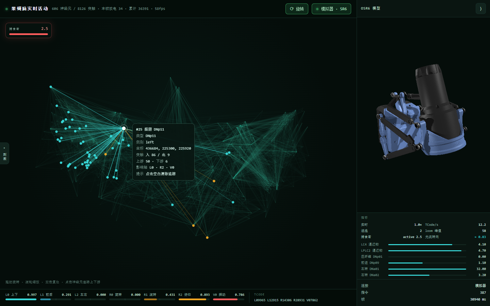

# OSR-FlyBrain

> 用果蝇的真实连接组驱动 OSR6 六轴设备。




一个跑在普通笔记本上的**实时果蝇脑**：从 FlyWire 全脑连接组里抽出 **606 个神经元、
8126 条化学突触**的功能子电路，以 1 kHz 做 LIF 仿真，每 20 ms 把群体活动映射成
OSR6 的六轴指令（TCode）。606 神经元实测 **70–96× 实时**。

不是"随机数驱动舵机"的演示：六轴里每一个值都能追到具体的神经元群，
loom 刺激会触发巨纤维逃逸，捕食者会被逃逸真的推开。

---

## 它是什么

```
FlyWire 连接组 ──抽子电路──▶ 606 神经元 LIF（1 kHz）
                                   │
                          每 20 ms 取各群放电率
                                   ▼
                         六轴映射（8 个功能群 → L1/L2/R0/R1/R2/V0）
                                   │
                        ┌──────────┴──────────┐
                        ▼                     ▼
                  OSR6 TCode 指令        网页实时可视化
                （模拟器 / 真机串口）    （脑活动 + 3D + 威胁 + 刺激）
```

**功能子电路**包含：LC4 / LPLC2（逼近物视觉）、DNp01 巨纤维（逃逸命令）、
JO 风感、DNp09 前进、MDN 后退、DNa 转向、DNg11 梳理、wing 运动群、
以及维持网络活动的伙伴神经元。

---

## 特性

- **真实连接组**：FlyWire v783，带真实突触方向、符号与权重（未做生理标定，见「已知限制」）
- **实时**：numba JIT 后端，606 神经元约 75–96× 实时；纯 numpy 约 17×
- **六轴 + TCode**：直接输出 OSR6 可识别的 `L0xxxx R0xxxx …` 指令
- **三态连接**：未连接时不发一个字节；可连本地模拟器或 USB 串口真机
- **捕食者闭环**：偶发威胁（10–50 s 随机），逃逸会真的把捕食者推开
- **视觉场 + 光流转向**：LC4/LPLC2 按左右侧定向驱动，光流让 L2/R0 背离捕食者
- **三条感觉输入**：转向（光流）、梳理（内部 bout）、振翅（气流 + 本体感觉），不再只靠噪声
- **指标面板 + 通路追踪**：实时放电率 / 逃逸 / loom 峰值；点神经元看上下游与影响轴
- **手动刺激**：左侧抽屉 7 个按钮，按下立刻触发，不用等事件
- **Web 可视化**：脑活动主视图 + 3D 模型抽屉 + 威胁 HUD + 六轴实时值

---

## 快速开始

```bash
pip install -r requirements.txt
python brain_loop.py --web
# 浏览器打开 http://127.0.0.1:8099/
```

Windows 下直接**双击 `start.bat`**（不受 PowerShell 执行策略限制）。
它会自动寻找带 numpy 的 Python（`.venv` → `py -3` → `python`），
打印 LIF 后端，然后开浏览器。

> 如果 `python` 报 `No module named numpy`，用 `py -3 brain_loop.py --web`
> 或先跑 `setup.ps1` 建虚拟环境。

### 场景

| 场景 | 说明 |
|---|---|
| `live` | **默认**。捕食者闭环 + 手动刺激 + 持续气流 |
| `demo` | 行为同 `live`，保留给演示 |
| `quiet` | 无离散刺激（受控实验） |
| `wind` | 只有风事件 |
| `flow` | 持续气流（前进通路） |

```bash
python brain_loop.py --ms 20000                 # 跑 20 秒，终端打印六轴范围
python brain_loop.py --web --port 8099          # 起网页
python brain_loop.py --scenario quiet            # 换场景
python brain_loop.py --feedback 0               # 关掉本体感觉回流
```

---

## 界面

| 区域 | 内容 |
|---|---|
| 中间 | 606 个神经元按 FlyWire voxel 坐标投影；连线是 8126 条化学突触（兴奋青绿 / 抑制暗红）；亮度是累计放电；白点+光环是当前帧放电 |
| 左抽屉 | **即时刺激**，默认收起。7 个按钮：立即惊吓 / 食物诱惑 / 一阵风 / 持续气流 / 振翅 / 梳理 / 后退 |
| 左上 | **威胁面板**：捕食者距离与逼近度，`>24` 绿 / `12–24` 琥珀 / `<12` 红；两次出现之间显示「无威胁」 |
| 右抽屉 | OSR6 的 3D 模型，默认 392 px，可收成 56 px |
| 右抽屉下半 | **指标面板**：实时倍率、TCode/s、逃逸次数、loom 峰值、捕食者、光流转向、8 个关键群放电率 |
| 点击神经元 | **通路追踪**：1 跳上下游（青=上游、琥珀=下游），显示影响的轴；点击空白清除 |
| 底部 | 七轴实时值 + 实际下发的 TCode 行（未连接时标为「预览（未下发）」） |

**连接是手动的**：顶栏「连接大脑模型」→ 选「模拟器（3D 模型）」或「真机（USB 串口）」。
未连接时 `LinkManager.send6()` 直接返回 0，不构造也不发送任何 TCode。

### 手动刺激

| 按钮 | 驱动群 | 效果 |
|---|---|---|
| 立即惊吓 | LC4 / LPLC2 同步脉冲 | 巨纤维逃逸 |
| 食物诱惑 | DNp09 前进群 | 前趋（**子图无嗅觉通路，代理**） |
| 一阵风 | JO 风感 | 翅 / 俯仰轻微变化 |
| 持续气流 | forward 上游 | 持续前进 |
| 振翅 | wing_a/b/c | V0 / L0 抬升 |
| 梳理 | DNg11 | R1 滚转摆动 |
| 后退 | MDN | L1 后退 |

### 捕食者闭环

`live` / `demo` 场景里有一个真正的捕食者：它在果蝇后方逼近，距离小于 12 才发
loom（每 15 ms 刷新 2 ms 同步脉冲）。果蝇的六轴每帧回灌世界（下一帧生效，
相当于 ~20 ms 感觉运动延迟），**逃逸是一次弹道式前冲**，会把捕食者推开、loom 自动停。

威胁是偶发的：**下一次出现 = 上一次出现 + 10–50 秒随机**；被躲开（或单次超过 10 s
兜底）后捕食者撤离，进入等待。60 s 实测出现间隔 36.1 s / 19.0 s。

---

## 六轴映射

| 轴 | 含义 | 来源 |
|---|---|---|
| **L0** | 上下 | 振翅升力；逃逸时压低 |
| **L1** | 前后 | 前进（DNp09）/ 后退（MDN）；逃逸前冲 |
| **L2** | 左右 | 转向（DNa 差值 + 光流背离） |
| **R0** | 旋转 | 转向时身体旋转（含光流） |
| **R1** | 滚转 | 梳理（DNg11） |
| **R2** | 俯仰 | 振翅 |
| **V0** | 振动 | 翅拍频率代理（`V0 × 250` ≈ Hz，0.8 ≈ 200 Hz） |

三条工程约束：转向只取变化量（8 s 慢基线）、迟滞 + 驻留、全部输出钳位到 `[0,1]`
并做 110 ms 平滑。

---

## HTTP 接口

| 方法 | 路径 | 说明 |
|---|---|---|
| GET | `/state` | 状态帧：六轴、当前放电、累计、连接、威胁、事件、指标 |
| GET | `/brain` | 脑拓扑：坐标、角色、边 |
| GET | `/metrics` | 指标：实时倍率、逃逸、loom 峰值、各群放电率、视觉状态 |
| GET | `/api/link` | 当前连接信息 |
| POST | `/api/link` | 连接 / 断开：`{"target":"emu"}`、`{"target":"serial","port":"COM3"}`、`{"target":null}` |
| GET | `/api/ports` | 串口列表 |
| POST | `/api/stim` | 手动刺激：`{"kind":"loom"}` |

---

## 目录结构

```
OSR-FlyBrain/
├── brain_loop.py            主循环：脑 1 kHz → 六轴 50 Hz → TCode
├── demo_brain.py            纯脑演示（无身体）
├── etl.py                   从 FlyWire 原始 CSV 抽功能子电路
├── requirements.txt
├── start.bat                Windows 一键启动
├── LICENSE                  Apache-2.0（代码许可）
├── NOTICE                   FlyWire 数据署名与 CC BY-NC 4.0 声明
├── body/
│   ├── world.py             虚拟环境：捕食者、loom/风、手动刺激
│   ├── mapping.py          脑活动 → 六轴（逐群标定、慢基线、迟滞、门控、平滑）
│   ├── device.py            LinkManager：未连接 / 模拟器 / 真机串口
│   ├── emu.py              OSR6 模拟器封装
│   ├── server.py           HTTP 服务 + SimRunner
│   ├── osr/                TCode 编码与 OSR6 模拟器
│   └── web/                前端（sim.html + 3D 库）
├── brain/
│   ├── circuit.py           电路加载
│   ├── lif.py               LIF 网络（numpy / numba 自动选择）
│   └── lif_jit.py           numba 内核
├── tests/
│   ├── test_behaviour.py    脑行为不变量与实时性能（19 项）
│   └── test_body.py         TCode 编码与闭环映射（26 项）
├── tools/                   诊断、标定、截图、性能测试
├── data/
│   ├── circuit.json         抽好的功能子电路（关键产物）
│   └── LICENSE              CC BY-NC 4.0（数据许可，不适用 Apache-2.0）
└── docs/preview.png         界面预览图
```

---

## 测试

不用 pytest，直接跑：

```bash
python tests/test_behaviour.py   # 19 项：电路完整性、静息、loom 选择性、不应期、实时性能
python tests/test_body.py        # 33 项：TCode、闭环、慢基线、逃逸门控、风感、视觉/光流、感觉驱动
```

实测：**52/52 全过**。

---

## 性能

| 后端 | 实时倍率 | 规模上限（参考） |
|---|---|---|
| 606 神经元 · numba JIT | **70–96×** | ~5 万神经元 |
| 606 神经元 · 纯 numpy | ~17× | ~5 千神经元 |

单步（1 ms，606 神经元 / 8126 突触）约 0.010–0.014 ms，预算 1.000 ms。

---

## 扩大电路 / 更换大脑模型

换到更强的机器后，想加神经元或换一套脑模型，按你改的层级分三种情况。
先记住三个契约，不管怎么换都别混：

| 层 | 文件 | 契约 |
|---|---|---|
| 数据 | `data/circuit.json` | `neurons[{id,type,role,side,pos}]` + `edges[[pre,post,weight]]` |
| 网络 | `brain/lif.py` | `build_from_circuit(c)` 返回 `.n/.rate/.active/.step(drive)/.reset()/.baseline/.noise` |
| 映射 | `body/mapping.py` | `REF[role]` + `_roles` → 六轴 |

### A. 同一套 FlyWire，加更多神经元

1. 装环境、下数据：

```bash
pip install -r requirements.txt
python tools/fetch.py --parts 8          # 4 个 gz，约 55 MB
```

2. 改 `etl.py` 的规模旋钮（第 32–38 行），或直接用 CLI：

| 常量 | 默认 | 作用 | 建议 |
|---|---|---|---|
| `PARTNERS_PER_GROUP` | 30 | 每个核心群拉多少伙伴 | 100 → 300 逐步试 |
| `ASCENDING_LIMIT` | 40 | 上行神经元上限 | 100–300 |
| `WIND_LIMIT` | 20 | JO 风感上限 | 60 |
| `SPECIFICITY` | 0.20 | 伙伴对目标群的输出占比下限 | 不低于 0.15 |
| `GAIN_E / GAIN_I` | 3.2 / 1.8 | 归一化后的总输入 | 扩规模后重标 |
| `ALPHA` | 1.0 | 归一化幂次 | 见下 |

```bash
python etl.py --partners 200 --ascending 100 --wind 60 --out data/circuit.json
```

3. **关键：扩规模必须改归一化。** `etl.py` 现在的权重是
   `w = syn · GAIN_E / (tot_post^α · ref^(1-α))`（α=1）。α=1 时每个突触后
   神经元的总兴奋输入被归一化到 `GAIN_E`，**上游一多，每条权重被稀释**——
   这就是 1144 神经元时 loom 触发从 19/20 掉到 0/20 的原因。两条路：
   - 保持 α=1，但按「来源群」归一化（每个 presynaptic 群对目标的总输入固定）；
   - α 降到 0.5–0.7，保留一部分突触数差异；代价是全部增益 / `REF` 重标。

4. 重标定 `body/mapping.py` 的 `REF`：跑 8–20 s，每 20 ms 采各群
   `net.rate.mean()`，取（中位 + p90）/2，让 50–60% 的时间输出落在 0.3–1.0。

5. 改测试硬编码：`tests/test_behaviour.py` 里 `len(gf)==2`、`len(lc4)==104`、
   `len(lp)==210`、`len(steer_l)==2` 等，换成新值或范围。

6. 验证：

```bash
python tests/test_behaviour.py
python tests/test_body.py
python tools/selectivity.py      # loom vs 非感觉，19/20 是基线
python tools/bench_step.py       # 实时倍率与规模曲线
python tools/verify_jit.py       # numba / numpy 必须逐位一致
```

7. **前端规模**：`/brain` 一次性发所有节点和边，`sim.html` 全量遍历。
   606 时约 1 MB；超过 3000 神经元要做服务端 LOD / 抽样、或把突触层改成
   WebGL / Three.js、或给 `/brain` 加 `?max=N`。

### B. 换 / 扩展功能群（加嗅觉、T4/T5）

1. 在 `etl.py` 的 `CORE_GROUPS` 加类型，`role_of` 会自动标成新角色。
2. 新角色必须补三处：`body/mapping.py` 的 `REF`、`body/world.py` 的
   `indices` / 刺激 / 驱动、`sim.html` 的 `ROLE_COLOR / ROLE_CN / ROLE_AXES`。
3. 现实提醒：当前子图没有 T4/T5、没有嗅觉 / 味觉。加它们不是多几个按钮，
   而是重新选种子 + 重新归一化 + 重标定。

### C. 换模型本身（HH / Brian2 / GPU / 全脑）

保持契约，换 `brain/lif.py`。新实现只要提供
`.n/.rate/.active/.step(drive)/.reset()`，`brain_loop.py`、`server.py`、测试都不用改。

- LIF 参数在 `brain/lif.py:9-16`（`DT_MS / TAU_M_MS / V_TH / REFRACT_MS /
  INH_DELAY_MS / RATE_TAU_MS / ADAPT_TAU_MS / ADAPT_GAIN`）。规模变大后
  SFA 与增益要重调，否则双稳态。
- GPU：`numba.cuda` 重写 kernel，或 Brian2CUDA / GeNN。全脑 13.9 万神经元、
  约 5000 万突触，稀疏 CSR 显存约 0.5–1 GB，需要独立显卡。
- 全脑实时是研究工程，不是改配置项。

### 换机器后先测什么

先跑 `python tools/bench_step.py`，它会给出「神经元数 → 实时倍率」的实测曲线。
参考：606 神经元是 70–96×；边数增长比神经元快，`--partners` 一大，
内存和单步都会先顶不住。

### 最小改动清单

- [ ] `etl.py`：`PARTNERS_PER_GROUP / ASCENDING_LIMIT / WIND_LIMIT / SPECIFICITY / ALPHA`
- [ ] `etl.py`：`CORE_GROUPS`（新类型 / 新角色）
- [ ] 归一化：按来源群归一化，或 α 降到 0.5–0.7
- [ ] `body/mapping.py`：`REF` + `_roles` + 增益
- [ ] `body/world.py`：新 role 的索引 / 刺激 / 驱动
- [ ] `sim.html`：`ROLE_COLOR / ROLE_CN / ROLE_AXES` + LOD
- [ ] `tests/test_behaviour.py`：硬编码计数
- [ ] `tools/selectivity.py / bench_step.py / verify_jit.py` 全过
- [ ] `data/circuit.json` 重生成

### 三件不要做

1. 只把 `--partners` 从 30 调到 1000 就完事——归一化稀释会让巨纤维选择性归零。
2. 改完电路不重标 `REF`——轴会不动或打满。
3. 前端直接上 13.9 万节点 / 5000 万边——浏览器会崩，必须先做 LOD 或 WebGL。

---

## 已知限制

- **不是全脑**：606 / ≈139,000 神经元（约 0.4%），是从 FlyWire 抽出的功能子电路。
  扩到 1144 个神经元时，巨纤维对 loom 的选择性会从 19/20 掉到 0/20（归一化被稀释）。
- **权重未做生理标定**：绝对放电率不可信，只有相对变化与选择性经过测试。
- **没有嗅觉 / 味觉通路**：子图里不存在相应神经元，所以「食物诱惑」是驱动 DNp09
  前进群的**前趋代理**，不是真的气味编码。
- **视觉只有 LC4 / LPLC2**：子图里没有 T4/T5，光流转向是「分侧 LC4/LPLC2 +
  运动能量代理」，不是完整的方向选择性视觉通路。
- **光刺激**未实现：LC4 / LPLC2 是逼近物检测器，不是通用光感受器。

---

## 数据来源与许可

- **代码许可**：**Apache License 2.0**，全文见 [`LICENSE`](LICENSE)。
- **连接组**：FlyWire 全脑连接组（v783）。若使用请引用
  *Dorkenwald et al., "Neuronal wiring diagram of an adult brain", Nature (2024)*。
- **数据许可**：FlyWire 数据为 **CC BY-NC 4.0**（署名 + **禁止商业使用**）。
  `data/circuit.json` 是它的派生数据，**继承同一许可，不适用 Apache-2.0**。
  详见 [`NOTICE`](NOTICE) 与 [`data/LICENSE`](data/LICENSE)。
- **商用**：代码本身可用 Apache-2.0，但数据层面的 NC 限制仍然存在——商用需先
  取得 FlyWire 数据方的额外授权，或替换为非 NC 授权的数据源。
- **TCode / OSR6**：协议参考 [multiaxis/TCode-Specification](https://github.com/multiaxis/TCode-Specification)。

---

## 致谢

FlyWire 连接组与社区工具链；OSR6 / TCode 协议作者；以及所有把果蝇脑
「接上身体」的开源项目。
